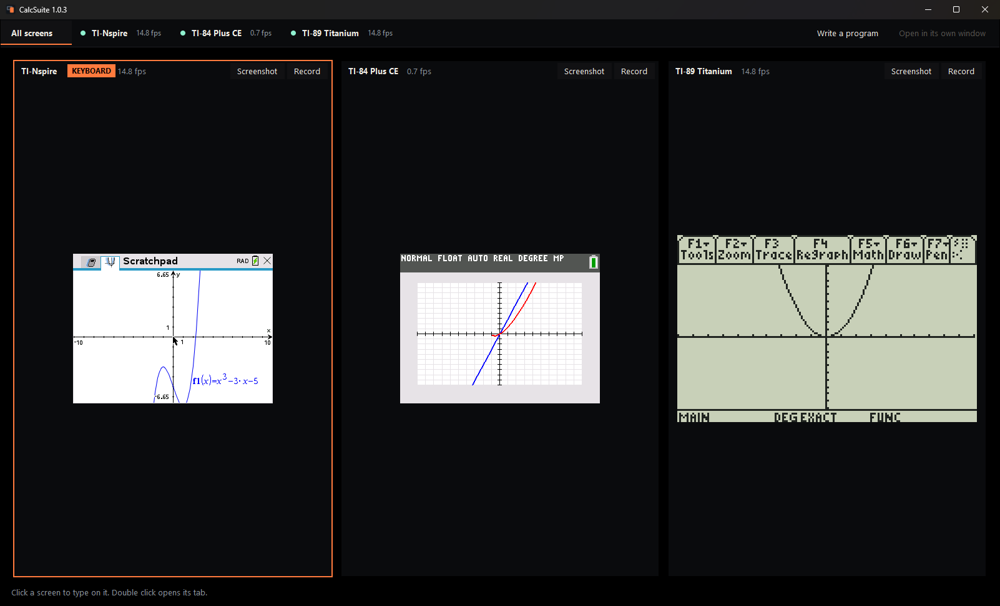
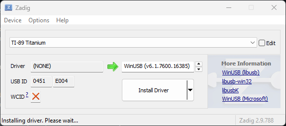
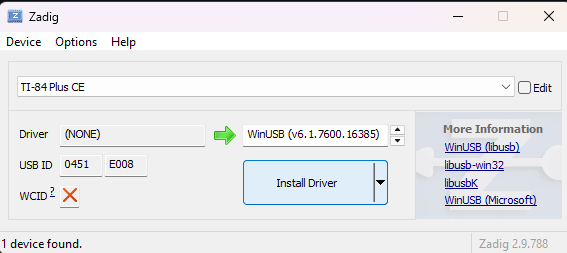
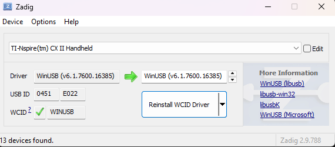
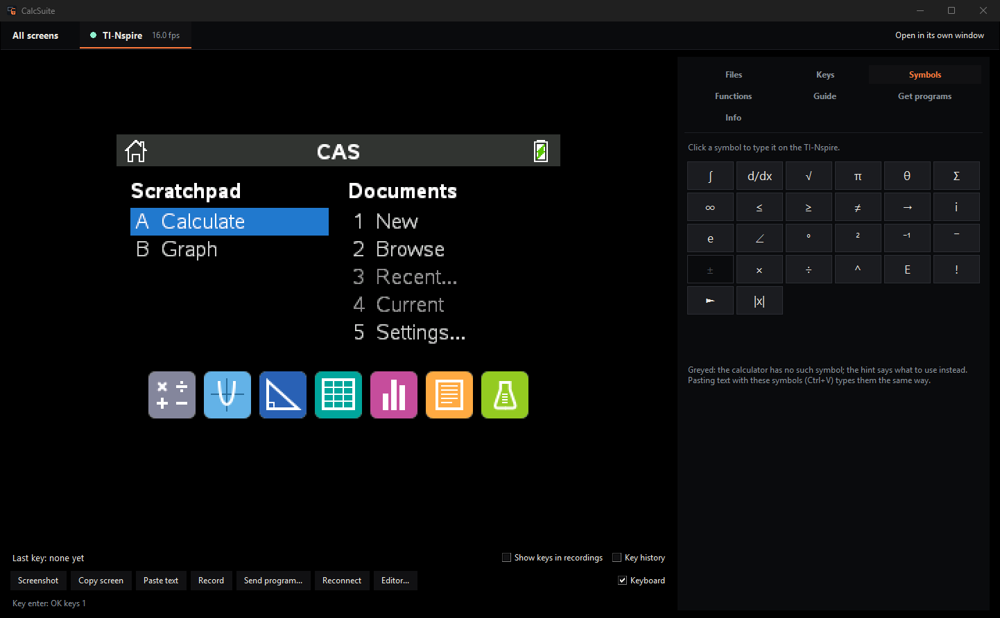
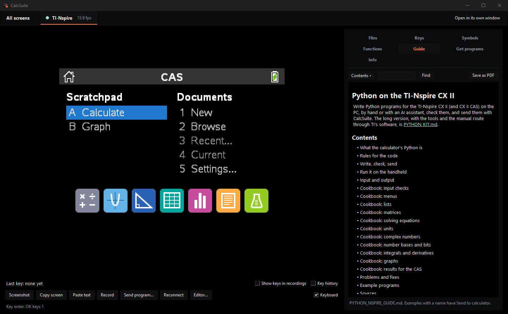

# CalcSuite

[](https://github.com/paul-kratky/CalcSuite/actions/workflows/tests.yml)
[](https://github.com/paul-kratky/CalcSuite/actions/workflows/fuzz.yml)
[](https://github.com/paul-kratky/CalcSuite/actions/workflows/codeql.yml)
[](https://scorecard.dev/viewer/?uri=github.com/paul-kratky/CalcSuite)
[](SECURITY.md#checking-a-download)

[](https://github.com/paul-kratky/CalcSuite/releases/latest)
[](https://github.com/paul-kratky/CalcSuite/releases/latest)
[](https://github.com/paul-kratky/CalcSuite/releases)
[](LICENSE)
[](SECURITY.md#what-calcsuite-does-and-doesnt-do)

[](https://github.com/paul-kratky/CalcSuite/commits/main)
[](https://github.com/paul-kratky/CalcSuite/commits/main)
[](https://github.com/paul-kratky/CalcSuite/stargazers)
[](https://github.com/paul-kratky/CalcSuite/forks)
[](https://github.com/paul-kratky/CalcSuite/issues)
[](https://github.com/paul-kratky/CalcSuite/issues?q=is%3Aissue+is%3Aclosed)
[](https://github.com/paul-kratky/CalcSuite/pulls?q=is%3Apr+is%3Aclosed)
[](https://github.com/paul-kratky/CalcSuite)
[](https://github.com/paul-kratky/CalcSuite)


Your TI calculators on your Windows PC, in one window: their screens live, your keyboard as
their keys, symbols and text pasted in, screenshots and recordings, programs sent over USB, the
files on them, and a guide for writing programs. For the **TI-Nspire CX II** (CAS too), the
**TI-84 Plus CE** and the **TI-89 Titanium**, several at once.



## Get started

1. **Download** `CalcSuite-<version>-win64.zip` from the
   [latest release](https://github.com/paul-kratky/CalcSuite/releases/latest) and **unzip it**
   (right-click, Extract All) wherever you like: Desktop, Documents, a USB stick. Nothing to
   install, no Python needed. Open `CalcSuite.exe` in the folder it makes (not from inside the
   zip). Everything CalcSuite saves stays in that folder, in `CalcSuite files`; the guides as
   PDFs are in `Guides`.

   If Windows shows **"Windows protected your PC"**, click **More info**, then **Run anyway**:
   CalcSuite isn't code-signed yet, so Windows doesn't know it. To check the download first, see
   [Is it safe?](#is-it-safe). The same zip is also a GitHub Package:
   `oras pull ghcr.io/paul-kratky/calcsuite:latest`.
2. **Open CalcSuite** with the calculators plugged in and switched on. Each one gets a tab; one
   plugged in later gets its tab by itself.
3. **The first time only:** Windows needs the WinUSB driver for each calculator, and TI's
   calculators don't bring it. When a calculator has no driver CalcSuite can use, CalcSuite
   opens its tab on **Info**, shows what it will change and asks **Change the driver?**. Press
   OK, then **Yes** on Windows' admin prompt. It takes a minute or two, once per calculator.
   (Later, **Info > Install the WinUSB driver...** does it again, and **Restore TI's driver...**
   gives TI's software its driver back.)

<details>
<summary><b>If that doesn't work: set the driver up with Zadig</b></summary>

1. Download and run [Zadig](https://zadig.akeo.ie/).
2. **Options > List All Devices**.
3. Pick the calculator:

   | Calculator | In Zadig's list | USB ID |
   | --- | --- | --- |
   | TI-Nspire CX II (CAS) | TI-Nspire(tm) CX II Handheld | `0451 E022` |
   | TI-84 Plus CE | TI-84 Plus CE | `0451 E008` |
   | TI-89 Titanium | TI-89 Titanium | `0451 E004` |

   If its Driver box already says `WinUSB`, it's done.
4. Choose **WinUSB** and press **Install Driver**. It takes a minute or two.





A TI-Nspire CX II whose Driver box says WinUSB (the button reads "Reinstall Driver") needs
nothing more.



</details>

Close TI's own software (TI Connect CE, CX II Connect) while you use it: only one program can
talk to a calculator at a time.

## The window

<details>
<summary>All screens, a calculator's tab, the Program editor tab and the side panel (Files, Keys, Symbols, Functions, Guide, Get programs, Info)</summary>

**All screens** (the first tab) shows every connected calculator's live screen side by side,
each with its frame rate, **Screenshot** and **Record**. Click a screen to type on that
calculator: it gets an orange outline and a **KEYBOARD** tag. Double click a screen to open its
tab.

**Program editor** (a tab beside the calculators, opened with **Program editor...**) is where
you write programs: [details](#sending-programs). Its tab shows the file's name, with a dot
while it has unsaved changes; **✕** closes it (asking first if there's something to save).

**A calculator's tab** shows its screen big, with **Screenshot**, **Copy screen**, **Paste
text**, **Record**, **Send program...** and **Keyboard** (on/off) under it, and **Last key:
F5 → GRAPH** so you see what each PC key did. **Key history** shows the last 8 keys as keycaps
under the screen; **Show keys in recordings** puts that strip into your GIF and MP4 too.
**Open in its own window** (top right) pops the calculator out into a window of its own;
closing that window puts it back as a tab. A calculator that's unplugged greys out ("not
plugged in") and comes back when you plug it in again. Drag the thin handle between the screen
and the side panel to make the panel wider; in **Functions**, drag the one under the list.


The panel on the right of a tab:

| | |
| --- | --- |
| **Files** | What's on the calculator: download to the PC, upload, show programs as text, delete (Nspire: folders, rename). **Back up...** and **Restore...** ([details](#files-backup-and-restore)). |
| **Keys** | Which PC key presses which calculator key, for this calculator, and the mouse. The key you just pressed lights up. |
| **Symbols** | ∫ d/dx √ π θ Σ ∞ ≤ ≥ ≠ → i e ∠ ° ² ⁻¹ and more: click one to type it on the calculator. A symbol the calculator doesn't have is greyed out and says what to use instead. |
| **Guide** | How to write programs for this calculator (TI-Basic for the 84 and the 89, Python for the Nspire), with a contents list and search. Every example has **Copy** and **Send to calculator**. |
| **Get programs** | Programs picked for engineering work (unit converters, circuit tools, a CAS for the 84, control and signals for the 89, formula libraries for the Nspire). **Download and send** gets one from ticalc.org or GitHub when you click it and sends it; the rest open their page. TI's own apps open TI's page (their licence). **Get all...** lists everything CalcSuite can send by itself, with sizes, notes and what's on the calculator already, and sends it all or saves it all to the PC. |
| **Info** | Model, OS, free memory, whether TI has a newer OS, the calculator's clock (**Set the clock to the PC's time** on the 84 and 89), **Exit Press-to-Test...**, **Delete all programs...** and **Reset the calculator...** ([details](#files-backup-and-restore)), **Reconnect**, **Make a PC copy...** / **Open my PC copy** (84 and 89), and the connection doctor: whether Windows' driver is right for CalcSuite, with the fix. |

 

</details>

## Where your files are

<details>
<summary>Everything CalcSuite saves stays in the folder you unzipped</summary>

Everything stays in the folder you unzipped, in `CalcSuite files`: `captures` (screenshots,
recordings, GIFs), `programs` (what you write, build and send), `backups` (and `backups\roms`
for the PC copy), `from-calc`, `library` (programs you download) and `cache` (what CalcSuite
downloads for itself: ffmpeg, the emulators). Move the folder and all of it moves; delete the
folder and CalcSuite is gone (the USB driver stays with Windows: **Info > Restore TI's
driver...** gives TI's software its driver back). Run from the source instead
(`python tools/mirror.py`), CalcSuite uses `Documents\CalcSuite` and `%LOCALAPPDATA%\CalcSuite`.

</details>

## Keys and mouse

<details>
<summary>Which PC key is which calculator key, and what the mouse does</summary>

What you type goes to the calculator: letters, digits and symbols as themselves (on the 84,
lower case is the capital). Keys go first: the picture catches up when you pause. The **Keys**
panel lists every key for the calculator in front of you.

| PC key | TI-Nspire | TI-84 Plus CE | TI-89 Titanium |
| --- | --- | --- | --- |
| Enter, arrows | enter, arrows | ENTER, arrows | ENTER, arrows |
| Esc | esc | CLEAR | ESC |
| Backspace | del | DEL (after the cursor moves left) | backspace |
| Tab | tab | | |
| Ctrl+letter | ctrl+letter | | |
| F1 ... F5 | home, menu, doc, catalog, var | Y=, WINDOW, ZOOM, TRACE, GRAPH | F1 ... F5 |
| F6 ... F12 | | MODE, MATH, APPS, PRGM, VARS, STAT, QUIT | F6, F7, F8, APPS, MODE, CATALOG, CLEAR |
| Home | | | HOME |
| Ctrl+V | types the PC's clipboard text, symbols too (new lines are Enter) | the same | the same |
| Ctrl+C | copies the screen as a picture | the same | the same |
| Ctrl+Shift+C / V | the handheld's own copy / paste | | |

| Mouse | TI-Nspire | TI-84 Plus CE | TI-89 Titanium |
| --- | --- | --- | --- |
| Wheel (Shift: sideways) | up / down | up / down | up / down |
| Click | click; the X closes the document, the page tabs change page | on a numbered menu line (MATH, PRGM, ...): picks it | on a toolbar tab: its F key |
| Double click | enter | ENTER | ENTER |
| Right click | the context menu | CLEAR | ESC |
| Middle click | menu | | HOME |

</details>

## Fast mode for the TI-84 Plus CE (experimental)

<details>
<summary>About 6 to 7 frames a second on the TI-84 Plus CE's home screen instead of under 1</summary>

The TI-84 Plus CE's own screenshot takes 1.2-1.4 s, so its picture moves at under 1 frame a
second. **Fast mode** (off until you turn it on) puts a small program of ours, CSFAST, on the
calculator. It adds a key hook that, when CalcSuite asks, packs the screen (only the rows that
changed) into a few AppVars that the link reads in about 0.15 s: about **6-7 frames a second**
on a still screen and **4-5 while typing**, and a key shows on the PC in about 0.3 s instead of
2 s. Measured on a TI-84 Plus CE, OS 5.4.0; details in `docs/dev/FAST84_PLAN.md`.

- **Needs OS 5.4 or older** (assembly programs). OS 5.5 and newer block them; arTIfiCE brings
  them back until the next reset, but CalcSuite doesn't install it. Press-to-Test blocks it too.
- **What it puts on the calculator** (only these names, nothing of yours is touched): the
  program CSFAST, the archived AppVar ZZHOOK (the hook's code), and in RAM CSSNAP, ZZWORK and
  up to eight ZZSNPA-ZZSNPH, about 40 KB of RAM while it's on (it leaves at least 16 KB free).
- **Turning it off** runs CSFAST again, which removes the hook, and deletes all of the above:
  the calculator is as it was. Running `prgmCSFAST` on the calculator toggles it too. A RAM
  reset removes the hook; CalcSuite notices and goes back to normal screenshots.
- Closing CalcSuite leaves Fast mode on the calculator (closing stays quick). That is safe: the
  hook only reacts to three key codes the keypad never sends; the calculator works as usual.
  Turn it off in CalcSuite when you want the RAM back.
- **Home screen only** (with its menus: MATH, PRGM, the catalog...). On the graph, table, Y=,
  mode and other screens TI's OS would jump back to the home screen when the link reads a
  variable, so there CalcSuite takes normal screenshots (under 1 frame a second) and the
  screen stays as it is. A screen too busy to pack, or a running program, also gets a normal
  screenshot, by itself.
- Back up before the first try (Files, Back up): a bug in a hook can crash a calculator, and a
  crash clears its RAM.

From the command line: `ti84-cli serve`, then `fast status`, `fast on tools/fast84/CSFAST.8xp`,
`snap FILE.ppm` (a frame; falls back to `shot` by itself), `fast off tools/fast84/CSFAST.8xp`.

</details>

## Screenshots and recordings

<details>
<summary>PNG, GIF and MP4 of the calculator's screen, with the keys you pressed</summary>

**Screenshot** saves a PNG in `CalcSuite files\captures`. **Record** records the screen
straight from the app, up to 3 minutes: always a GIF, and an MP4 too with
[ffmpeg](https://ffmpeg.org/). No ffmpeg on your PC? The first time you press Record, CalcSuite
offers to download it for you (free, about 39 MB, once). Say no to keep the GIF only.

</details>

## Sending programs

<details>
<summary>Send program..., the Program editor, and what each calculator accepts</summary>

**Send program...** in a calculator's tab:

- **TI-Nspire:** a `.py` (checked and converted first) or a `.tns`.
- **TI-84 Plus CE and TI-89 Titanium:** TI-Basic typed on the PC (a `.txt`, `.tib` or `.bas`)
  or a ready TI file (`.8xp`, `.89p`, ...).

It asks before replacing anything on the calculator. The **Guide** panel's examples send in one
click. How to write the text: [TI-Basic from the PC](#ti-basic-from-the-pc).

### The program editor

Write TI-84 Plus CE TI-Basic, TI-89 Titanium TI-Basic or Nspire Python in CalcSuite itself:
**Program editor...** under a calculator's screen opens the **Program editor** tab, aimed at that
calculator (`python -I tools/editor.py [file]` opens it as a window of its own). It checks as
you type, underlines each
mistake and lists it with its fix (F8 goes to the next one), colours the code like VS Code,
completes command names (Ctrl+Space) and shows the command's syntax with the current argument
in bold. **Build** (Ctrl+B) makes the calculator's file (`.8xp`, `.89p`, `.tns`) in
`CalcSuite files\programs\<calculator>\` with the source beside it; **Copy file** puts it
on the clipboard for Discord or e-mail. **F5** checks, builds, sends and runs it (the Nspire:
sends it; open it on the handheld), **F6** sends only. Nothing is built or sent while there are
errors. **Copy AI instructions** gives a chat AI the rules for your calculator; paste its
answer into an empty editor and **Copy problems for the AI** hands back what the checker found.
**Ctrl+Backspace** and **Ctrl+Delete** delete a word at a time, **Ctrl+/** comments a line out,
**Ctrl+F** finds.

</details>

## Files, backup and restore

<details>
<summary>Browse, download, upload and delete, back up and restore, clear a calculator, OS updates, Press-to-Test</summary>

| | TI-Nspire CX II | TI-84 Plus CE | TI-89 Titanium |
| --- | --- | --- | --- |
| Browse | folders and files, with sizes | variables, programs, apps, with sizes and RAM/Archive | variables by folder, apps |
| Download | any file | as TI files (`.8xp`, `.8xv`, `.8xl`, ...) | as TI files (`.89p`, `.89e`, ...) |
| Show as text | | TI-Basic programs, strings, equations | texts, strings, programs not yet run |
| Upload | `.py` (checked and converted) or `.tns` | TI files (`.8xp` etc.) or TI-Basic text | TI files (`.89p` etc.) or TI-Basic text |
| Delete, new folder, rename | yes (folders must be empty to delete) | delete | delete |

Downloads go to `CalcSuite files\from-calc` unless you pick another folder.

**Back up...** copies everything the link can read to
`CalcSuite files\backups\<model>-<date>` (Nspire: every file, folders kept; 84: TI files
and a `.b84` bundle; 89: TI files and a `.89g` group; a `manifest.json`). Apps and the OS can't
be read: they're listed as skipped. **Restore...** shows what's in a backup, sends what you
pick, and asks before replacing anything. It never wipes the calculator.

**Info** checks TI's website once a day for a newer OS and links to TI's download page.
CalcSuite never downloads or installs an OS itself. (On the 84, OS 5.5 and later no longer run
assembly programs.) The Nspire's clock can't be read or set over USB: set it on the handheld.
**Exit Press-to-Test...** uses TI's own way only: for the Nspire, CalcSuite lets go of the
handheld and opens TI-Nspire CX II Connect; for the 84, TI's steps. The TI-89 Titanium has no
Press-to-Test.

### Clearing a calculator

Both are in **Info**, and both back up the whole calculator first (into
`CalcSuite files\backups`), so **Restore...** can bring things back.

- **Delete all programs...** (Nspire: **Delete all documents...**): every program (the 89: and
  function; the Nspire: every `.tns` and `.py`). Apps, the OS and your other variables stay.
- **Reset the calculator...**: on the TI-84 Plus CE, **Clear RAM** or **Everything (like new)**,
  after you type `RESET`; CalcSuite presses the 84's own reset menu (2nd MEM, 7: Reset...) for
  you. The TI-89 Titanium and the Nspire reset only from the calculator itself: CalcSuite shows
  the steps.

</details>

## A PC copy of your calculator

<details>
<summary>Your own calculator running in an emulator on the PC, from its own ROM</summary>

`python -I tools/pc_copy.py make 84` (or `89`) backs the calculator up, copies its ROM to
`CalcSuite files\backups\roms\`, removes what it put on the calculator, and opens the copy
in CEmu with your programs and variables (the 84 Plus CE, OS 5.4 or older). For the TI-89
Titanium it makes the ROM; its emulator, TiEmu, you install yourself. The ROM is TI's software
from your own calculator: it stays on your PC and is never uploaded. In the window: Info >
**Make a PC copy...**. Details: [docs/PC_COPY.md](docs/PC_COPY.md).

</details>

## TI-Basic from the PC

<details>
<summary>Typing TI-Basic on the PC: the spellings and symbols each calculator takes</summary>

Write the program in any text editor (or take one from the **Guide** panel) and send it with
**Send program...** (or **Upload** in **Files**, or `python -I tools/send_ti.py --calc 84|89
FILE`, which adds `--name`, `--replace` and `--out FILE` to only make the TI file).

- **TI-84 Plus CE:** the app turns the text into the calculator's tokens. Write it as the
  calculator shows it, or with the PC spellings: `->` for the store arrow, `<=` `>=` `!=`,
  `sqrt(`, `pi`, `theta`, `^2`, `^-1`, `L1`, `Y1`, `E` in a number for the EE key, `-` at the
  start of a number for the negative sign. The symbols work too (`→ ≤ ≥ ≠ √ π θ ² ⁻¹`). A `:`
  at the start of a line is fine. Spaces only count inside strings. The program is named after
  the file (`HELLO.txt` is `HELLO`; up to 8 capitals), or the app asks. Run it with PRGM.
  A word outside a string with lower case letters that isn't a command (`textcolor(`) gets a
  warning before sending: the calculator would stop there.
- **TI-89 Titanium:** the program goes over as text, the way the 89's own Program Editor keeps
  it, and the 89 turns it into its tokens the first time it runs. Start with the program's
  line and `Prgm` / `EndPrgm` (`Func` / `EndFunc` makes a function):

  ```
  hello()
  Prgm
  ClrIO
  Disp "Hello"
  EndPrgm
  ```

  or write only the body (a program with no arguments, named after the file). The same PC
  spellings work (`->`, `<=`, `>=`, `!=`, `sqrt(`, `pi`, `theta`), and `@>` for ► (`10@>Bin`,
  `3_m@>_ft`), `@int(` for ∫(, `@d(` for d(, `@sum(` for Σ(, `@angle` for ∠, `@i` for 𝑖.
  Run it by typing `hello()`.

The full guides: [TI-84 Plus CE](docs/TIBASIC_84.md), [TI-89 Titanium](docs/TIBASIC_89.md),
[Python on the Nspire](docs/PYTHON_NSPIRE_GUIDE.md) (the same ones as in the **Guide** panel).

As dark PDFs (also **Save as PDF** in the Guide and Functions panels, and on each release): [TI-84 Plus CE guide](docs/pdf/CalcSuite%20-%20TI-84%20Plus%20CE%20TI-Basic%20guide.pdf), [TI-89 Titanium guide](docs/pdf/CalcSuite%20-%20TI-89%20Titanium%20TI-Basic%20guide.pdf), [Nspire Python guide](docs/pdf/CalcSuite%20-%20TI-Nspire%20CX%20II%20Python%20guide.pdf);
Functions references [TI-84 Plus CE](docs/pdf/CalcSuite%20-%20TI-84%20Plus%20CE%20functions%20reference.pdf), [TI-89 Titanium](docs/pdf/CalcSuite%20-%20TI-89%20Titanium%20functions%20reference.pdf), [TI-Nspire CX II](docs/pdf/CalcSuite%20-%20TI-Nspire%20CX%20II%20functions%20reference.pdf); [user guide](docs/pdf/CalcSuite%20-%20User%20guide.pdf), [quick start](docs/pdf/CalcSuite%20-%20Quick%20start.pdf), [Python kit](docs/pdf/CalcSuite%20-%20TI-Nspire%20Python%20kit.pdf).

</details>

## If something doesn't work

<details>
<summary>Fixes for the common problems</summary>

Open the calculator's **Info** panel first: the connection doctor says what Windows has on it
and what to do.

| Problem | Fix |
| --- | --- |
| The tab says it's looking for the calculator | Switch it on (they sleep after a few minutes), use a data cable (some only charge), close TI's software, try another USB port. |
| A calculator never connects | Its driver: **Info > Install the WinUSB driver...** (it shows what it will do first, and Windows asks for admin rights). If that fails, the Zadig steps under [Get started](#get-started). |
| TI's own software no longer sees the calculator | That's the WinUSB driver. **Restore TI's driver...** in **Info** gives it back, or: Device Manager > the calculator > Uninstall device, with "delete the driver" ticked. |
| A key does nothing | Some special keys aren't mapped yet: [open an issue](https://github.com/paul-kratky/CalcSuite/issues) with the key and the calculator. |
| Something in the window stays on "Asking..." or doesn't react | Look in `CalcSuite files\logs\errors.log`: every error inside the window is written there. Attach it to an [issue](https://github.com/paul-kratky/CalcSuite/issues). |
| "Windows protected your PC" | **More info**, then **Run anyway** (CalcSuite isn't code-signed yet). Check the download first: [Is it safe?](#is-it-safe) |

</details>

## Is it safe?

<details>
<summary>What CalcSuite does and doesn't do, and how to check a download</summary>

- **No telemetry, nothing in the background.** CalcSuite goes online only when you ask: TI's
  site (OS versions), ticalc.org and GitHub (programs you pick), PyPI (ffmpeg, for video) and
  the emulators' pages (PC copy). Admin rights only for the USB driver, after showing what will
  change. Your ROM never leaves your PC. Details: [SECURITY.md](SECURITY.md).
- **Built in the open.** Every release is built by GitHub from this repository's code, not on
  anyone's PC; the release notes give the zip's SHA-256 and a VirusTotal scan, and GitHub signs
  where it was built. Check a download with the GitHub CLI:
  `gh attestation verify CalcSuite-<version>-win64.zip -R paul-kratky/CalcSuite`.
- **Signed and checked.** Release tags and commits are signed (GitHub shows **Verified**);
  CodeQL scans the code and OpenSSF Scorecard rates the project (the badge at the top).

</details>

## Writing Python programs

<details>
<summary>The command-line kit for TI-Nspire Python (developers)</summary>

CalcSuite also has a kit for writing Python programs for the TI-Nspire CX II on the PC, with or
without an AI assistant: a checker for what the calculator's Python can run, a runner on the PC,
and sending in one step. See [docs/PYTHON_KIT.md](docs/PYTHON_KIT.md), or the one-page
[QUICKSTART.md](QUICKSTART.md).

From the source: `CalcSuite.bat` (or `python -I tools/mirror.py`). CalcSuite was called Nspire
Mirror before 1.0; its files in `Documents\Nspire Mirror` are copied to `Documents\CalcSuite`
the first time it starts (nothing is deleted).

What's new: [CHANGELOG.md](CHANGELOG.md).

**Licence:** MIT ([LICENSE](LICENSE)), except the link tools, the driver helper, the .tns
writer and `third_party/`, which keep their own licences: [LICENSING.md](LICENSING.md). Programs from **Get programs** keep their authors' licences: CalcSuite
links to them and downloads them only when you ask. Not affiliated with Texas Instruments.

</details>
