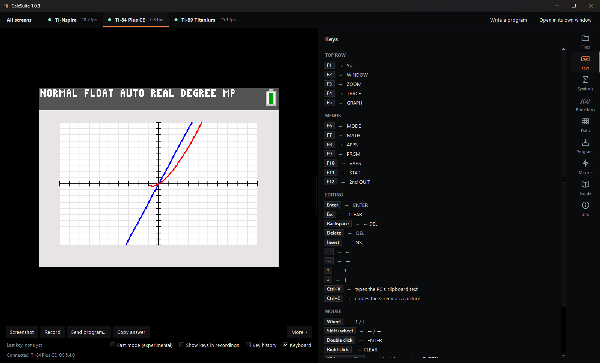
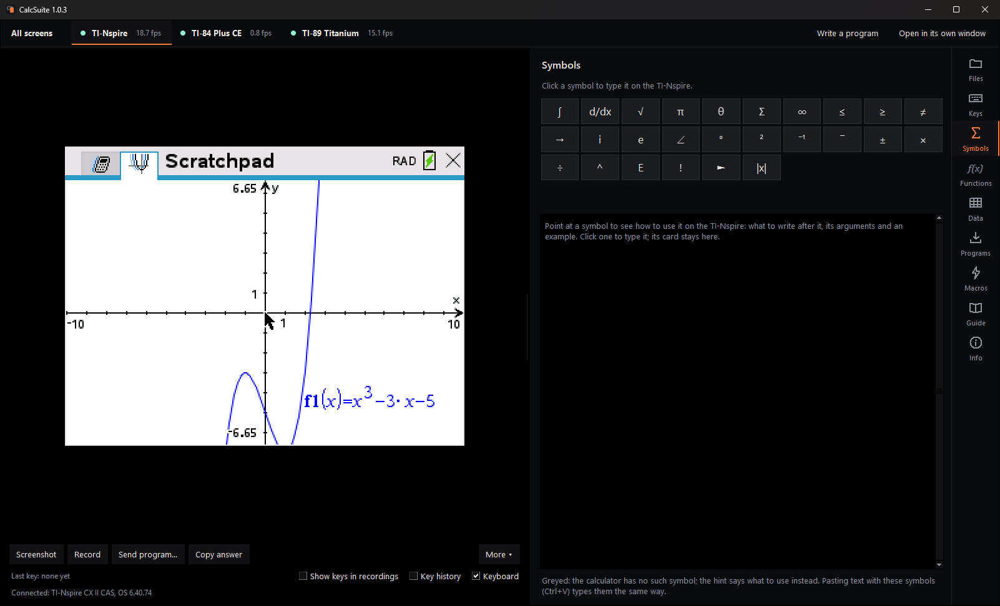
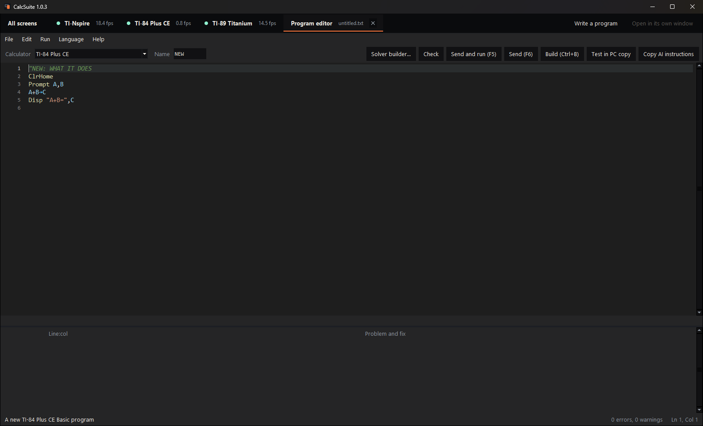
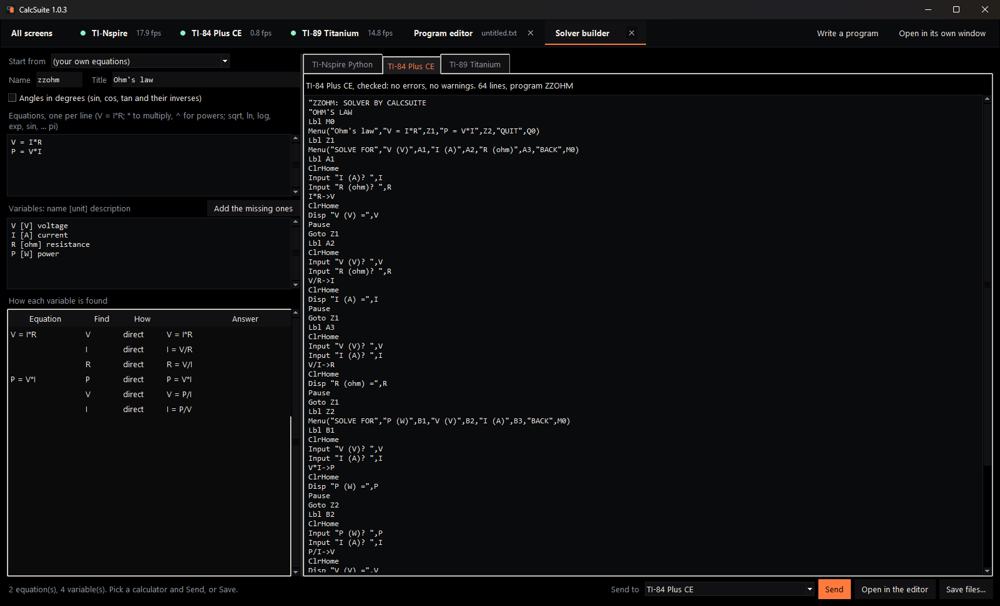
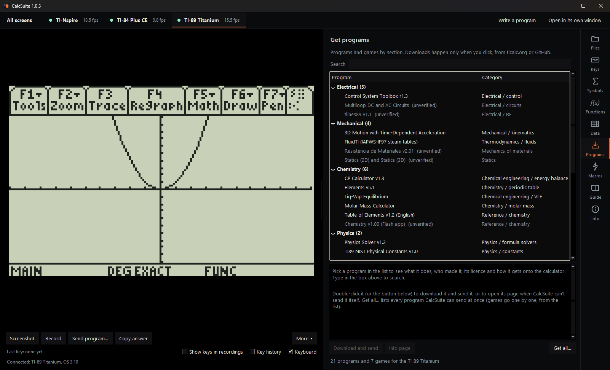
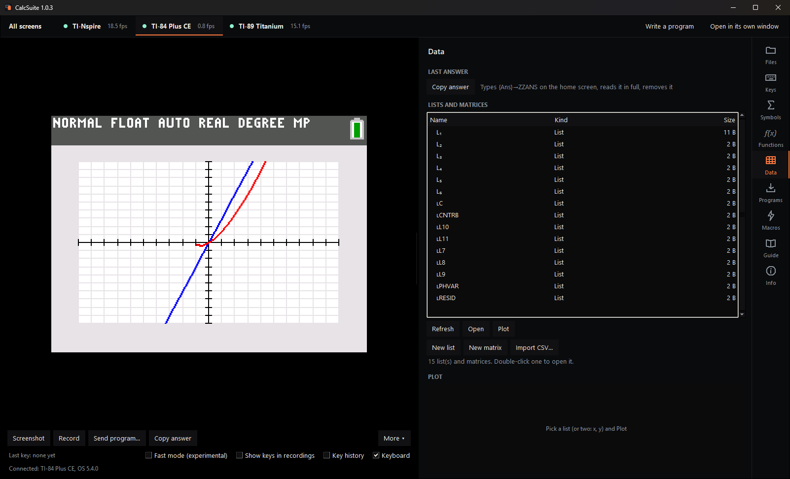
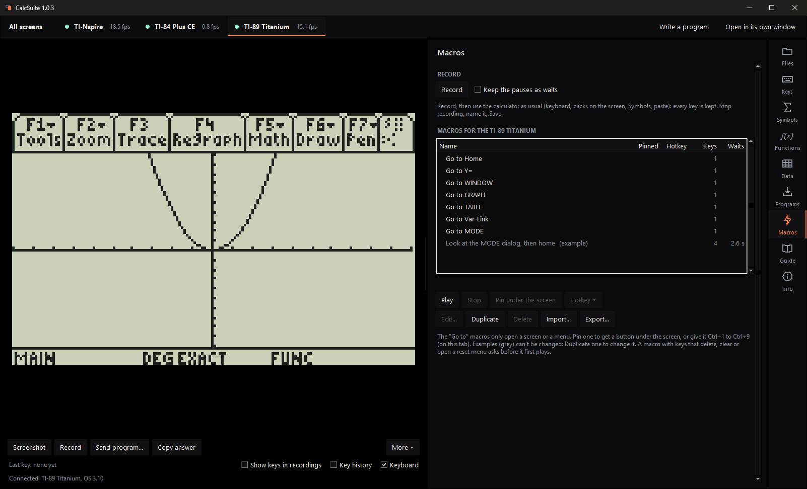

# CalcSuite

Your TI calculators on your Windows PC, in one window: their screens live, your keyboard as
their keys, programs written and sent over USB, their files, lists and backups, and a copy of the
calculator that runs on the PC. For the **TI-Nspire CX II** (CAS too), the **TI-84 Plus CE** and
the **TI-89 Titanium**, several at once.

## Get started

1. **Download** `CalcSuite-<version>-win64.zip` from the
   [latest release](https://github.com/paul-kratky/CalcSuite/releases/latest) and unzip it
   anywhere (Desktop, a USB stick). Nothing to install, no Python. Open `CalcSuite.exe` in the
   folder it makes. Everything it saves stays in that folder.
2. If Windows says **"Windows protected your PC"**: **More info**, then **Run anyway**
   (CalcSuite isn't code-signed yet; [check the download](SECURITY.md#checking-a-download) if you
   like).
3. **Plug in the calculators and switch them on.** Each gets a tab. The first time, CalcSuite
   sets up the USB driver for each one (one admin prompt). If that fails, the
   [user guide](docs/USER_GUIDE.md#get-started) has the Zadig steps.

No calculator? **Write a program** works without one.

## What it does

**Live screens and your keyboard.** Click a screen and type: your keys press the calculator's
(the Keys panel lists them). Screenshots, recordings, pasted text, Copy answer.

**Symbols.** One click types ∫, √, π, ≤, → and the rest the way each calculator does it (the
Nspire's through its own menus).

**Write programs, with or without a calculator.** TI-Basic for the 84 and the 89, Python for the
Nspire, with checkers that catch mistakes before the calculator does. **Solver builder** turns
equations (`V = I*R`) into a menu-driven solver for all three. **Test in PC copy** runs an 84
program in the emulator first.

**Get programs.** Engineering tools and games for each calculator, by section (Electrical,
Mechanical, Chemistry, Physics, Math, Games...), with search.

**Data.** The calculator's lists and matrices in a grid: edit, paste to and from Excel, CSV,
plot, send back.

**Macros.** Record keys and play them back; one-click "Go to" macros (Y=, WINDOW, TABLE...),
pinned as buttons or on Ctrl+1 to 9.

**Also:** files on the calculator, backups and restore, compare two backups, pictures made into
calculator images, **PC copy** (your own calculator's ROM running in CEmu or TiEmu in a tab), and
TI's OS update check.

## Guides

| Guide | |
| --- | --- |
| [User guide](docs/USER_GUIDE.md) | everything above in detail, keys, files, problems |
| [Quick start](QUICKSTART.md) | five minutes from download to the first program |
| [TI-84 Plus CE TI-Basic](docs/TIBASIC_84.md) · [TI-89 Titanium TI-Basic](docs/TIBASIC_89.md) · [TI-Nspire Python](docs/PYTHON_NSPIRE_GUIDE.md) | writing programs |
| [PC copies (CEmu and TiEmu)](docs/EMULATORS.md) · [Data](docs/DATA_BRIDGE.md) | the emulators and their keys; lists, matrices, Copy answer |
| [TI-Nspire Python kit](docs/PYTHON_KIT.md) | the command-line kit for developers |

The release's `Guides` folder has all of them as PDFs.

## Is it safe?

No account, no telemetry, online only when you ask (downloads, the OS check). Releases are built
on GitHub from this source, signed and scanned: [SECURITY.md](SECURITY.md) says how to check one
and how to report a problem.

## From the source

Python 3.11 on Windows: `python tools/mirror.py` (or `CalcSuite.bat`). The USB helpers build with
`python -I tools/build_tools.py` (MSYS2 UCRT64); `python -I tools/selftest/run_selftest.py` runs
every test. [CHANGELOG.md](CHANGELOG.md) says what changed.

## Licence

MIT ([LICENSE](LICENSE)). The USB helpers and the emulators are separate programs under their own
licences: [LICENSING.md](LICENSING.md).
